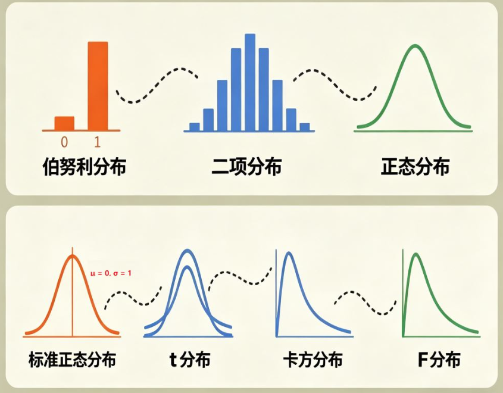

#一、一切的起点：伯努利分布
所有分布的源头，都来自最简单的随机试验——抛硬币。

一次试验只有两种结果：成功/失败、正面/反面。
这种试验叫作伯努利试验。
对应结果的概率分布，就是伯努利分布。
它是所有离散分布的基础，结构最简单、最直观。

#二、多次重复：二项分布
把伯努利试验同时进行多次，就得到了二项分布。

例如：一次抛5枚、10枚、50枚硬币。
观察“成功次数”（如正面次数）的概率规律。
特征：中间概率最高，向两侧逐渐降低。
简单说：
伯努利分布 × 多次重复 = 二项分布

当你抛的次数（n）越来越多，这个分布的图形就会越来越像一座钟。

#三、数量变大：收敛为正态分布
当二项分布的试验次数 n 越来越大时，分布会越来越密集、平滑，最终形成左右对称的钟形曲线。
这就是最重要的正态分布。

近似条件：
np ≥ 5 且 n(1−p) ≥ 5

特点：

由均值μ和方差σ²唯一确定。
自然界、社会、金融数据中最常见的分布。

#四、统一标准：标准正态分布（Z分布）
不同正态分布的均值、标准差各不相同，难以直接比较。因此我们对它做标准化处理：

Z = (X − μ) / σ

处理后：

均值 μ = 0
标准差 σ = 1
这样得到的分布叫作标准正态分布（Z分布），是所有正态分布的“统一标尺”。

#五、现实修正：t分布
标准正态分布有一个强前提：总体方差已知。
但在真实研究中，总体方差几乎永远未知，只能用样本方差代替。

由于样本量小、不确定性更高，曲线会变成：

中间更矮
两侧尾部更厚
整体更“矮胖”
这就是t分布。
特点：

样本量越大，越接近标准正态分布。
n ≥ 30 时，几乎与Z分布一致。
适用场景：总体方差未知、小样本。

样本量（n）越小，曲线越矮胖；当样本量够大（$n \ge 30$）时，t分布就和Z分布长得一模一样了。

总体方差未知 + 小样本 ⇒ 用t分布

#六、平方构造：卡方分布（χ² 分布）
从标准正态分布出发，将随机变量 Z 平方，得到的分布就是卡方分布。

特点：

只在0右侧取值，呈偏态。
由自由度决定形状：自由度越大，越趋近对称。
多用于方差检验、拟合优度检验。
多个独立Z的平方和，也服从卡方分布。

如果你把5个独立的Z平方后加起来，就是自由度为5的卡方分布。

#七、分布之比：F分布
取两个相互独立的卡方分布，分别除以各自自由度后再相除，得到的变量服从F分布。

特点：

同样只在0右侧，呈偏态。
由分子自由度、分母自由度共同决定。
多用于方差分析、回归显著性检验。
主要用于比较两个总体的方差是否相等（比如方差分析）。