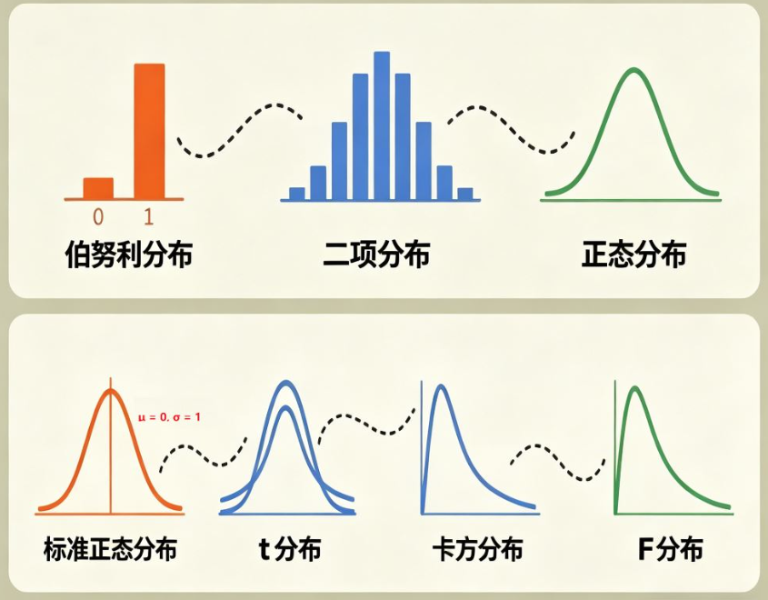

> 出处待补：本卡内容来自 Claude 对话（inbox: distribution.md，附图 distribution.png），属 AI 生成内容，未引用原始文献。

## 一句话定义

统计检验里常见的几个分布不是孤立的，而是一条"演化链"：从抛硬币的**伯努利分布**出发，重复多次得到**二项分布**，n 变大后逼近**正态分布**；标准化得到 **Z 分布**；再用它构造出检验统计量的三把"尺子"——**t、χ²、F 分布**。

## 演化链

| 步骤 | 分布 | 怎么来的 | 形状 / 特点 | 参数 |
|---|---|---|---|---|
| 1 | 伯努利（Bernoulli） | 一次试验，只有成功 / 失败两种结果（抛一次硬币） | 只在 0、1 两点取值 | 成功概率 p |
| 2 | 二项（Binomial） | 伯努利试验重复 n 次，数"成功次数" | 中间概率最高，向两侧降低；n 越大越像钟形 | n, p |
| 3 | 正态（Normal） | 二项分布 n 很大时的极限：分布越来越密集、平滑，成为左右对称的钟形曲线 | 对称钟形 | 均值 μ、方差 σ² |
| 4 | 标准正态（Z） | 对正态分布标准化：Z = (X − μ) / σ | 均值 0、标准差 1，所有正态分布的"统一标尺" | 无 |
| 5 | t | 总体方差未知，用样本方差代替 | 比 Z 中间更矮、尾部更厚 | 自由度 df |
| 6 | 卡方（χ²） | Z 平方；k 个独立 Z 的平方和服从自由度 k 的 χ² | 只在 0 右侧取值，右偏；df 越大越对称 | 自由度 df |
| 7 | F | 两个独立 χ² 各除以自己的自由度后相除 | 只在 0 右侧取值，右偏 | 分子 df、分母 df |

口诀：**伯努利 × 多次重复 = 二项；二项 + n 很大 → 正态；正态标准化 → Z；Z 的平方（和）→ χ²；χ² 之比 → F。**

## 各分布要点

### 二项 → 正态的近似条件

材料给出的条件：**np ≥ 5 且 n(1 − p) ≥ 5**。

> 补充（Claude）：这一步背后是中心极限定理。二项分布的均值为 np、方差为 np(1 − p)，近似时用 N(np, np(1 − p))。"≥ 5"是常见经验门槛，也有教材用 ≥ 10，更保守。待 Li 核实。
>
> 临床试验里的对应：比例的 Wald 置信区间、两比例 z 检验、Pearson χ² 检验都依赖这个正态近似；期望频数太小（如 < 5）时要改用 Fisher 精确检验或精确置信区间（第 4 章待建）。

### Z 分布

不同正态分布的均值、标准差各不相同，没法直接比较；标准化 Z = (X − μ) / σ 后都变成均值 0、标准差 1 的同一条曲线。

### t 分布

标准正态的前提是**总体方差已知**；现实中总体方差几乎总是未知，只能用样本方差代替，多了一层不确定性，于是曲线"矮胖"、尾部更厚。样本量越大越接近 Z 分布。详见 [CON-t-distribution](CON-t-distribution.md)（材料中"n ≥ 30 时与 Z 分布一模一样"的说法及其分歧记录在那张卡片里）。

> 补充（Claude）：t 分布的构造是 t = Z / √(χ²_df / df)，即分子是标准正态、分母是"独立的 χ² 除以自己的自由度再开方"。所以 t 也是从 Z 和 χ² 搭出来的，并且 t² 服从 F(1, df)。待 Li 核实。

### χ² 分布

- Z² 的分布；**5 个独立 Z 平方后相加，就是自由度为 5 的 χ² 分布**。
- 只在 0 右侧取值、右偏；自由度越大越趋于对称。
- 材料列出的用途：方差检验、拟合优度检验。

> 补充（Claude）：临床统计里更常见的是**列联表独立性检验**（如 2×2 表比较两组应答率）和 **log-rank 检验**（统计量按 χ²(1) 查 P 值），见 [CON-test-statistic](CON-test-statistic.md)。χ² 检验的自由度怎么算见 [CON-degrees-of-freedom](CON-degrees-of-freedom.md)。

### F 分布

- 两个独立 χ² 各除以自由度后的比值。
- 只在 0 右侧取值、右偏；由**分子自由度、分母自由度**两个参数共同决定。
- 材料列出的用途：方差分析、回归显著性检验，以及"比较两个总体的方差是否相等（比如方差分析）"。

> 补充（Claude）：最后一句容易误解。**方差分析（ANOVA）检验的是多组均值是否相等**，只是做法是比较"组间变异 / 组内变异"这两个方差估计的比值，所以用 F 分布；它不是在检验两个总体方差是否相等。检验两总体方差是否相等的是另一个 F 检验（如 SAS PROC TTEST 输出的 "Equality of Variances" 折叠 F 检验）。临床试验输出中常见的 F 还包括 PROC MIXED / PROC GLM 的 Type III 固定效应检验（`F Value`、`Num DF`、`Den DF`）。待 Li 核实。

## 和检验统计量的对应

| 分布 | 作为零分布用于 |
|---|---|
| Z（标准正态） | 大样本比例检验、Wald 检验 |
| t | t 检验、回归 / 混合模型中单个系数或 LS mean 差的检验 |
| χ² | 列联表检验、log-rank、似然比检验 |
| F | ANOVA、模型中的多自由度固定效应检验 |

> 补充（Claude）：本表为 Claude 整理，非材料原文。这几个分布就是 [CON-p-value](CON-p-value.md) 中"零分布"的常见选择。

## 相关卡片

- [CON-t-distribution](CON-t-distribution.md)：t 分布的形状与自由度
- [CON-degrees-of-freedom](CON-degrees-of-freedom.md)：t、χ²、F 的自由度怎么算
- [CON-test-statistic](CON-test-statistic.md)：t、χ²、log-rank 统计量及其"亲戚关系"
- [CON-p-value](CON-p-value.md)：零分布在 P 值计算中的角色

## 出处

- Claude 对话（inbox: distribution.md，附图 distribution.png；AI 生成，原始出处待补）
